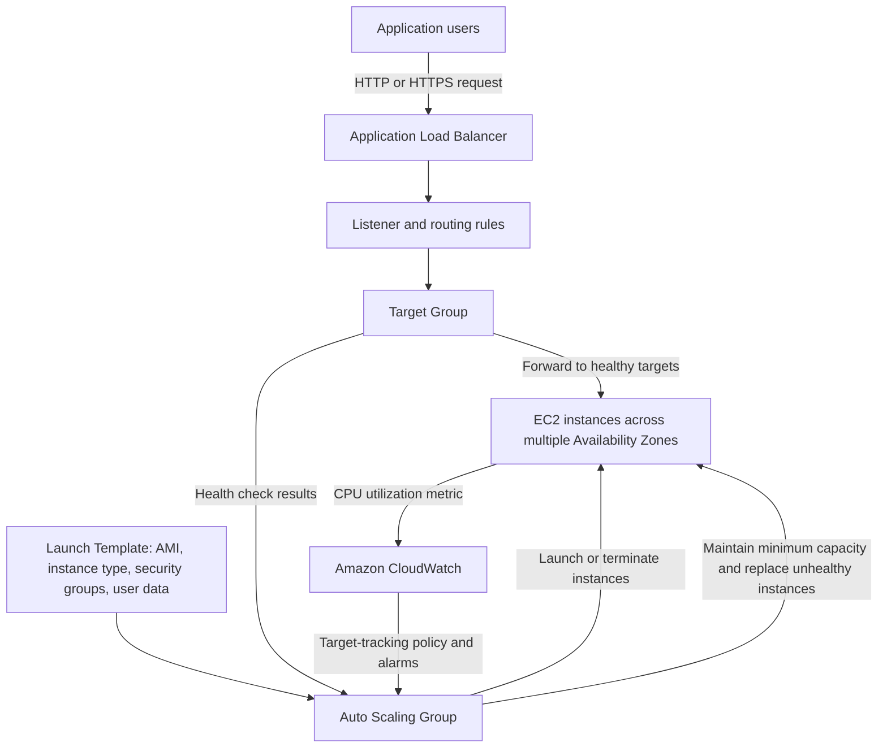

# EC2 Auto Scaling and Load Balancing

An AWS architecture example for distributing HTTP application traffic across EC2 instances and adjusting instance capacity as demand changes.

## Architecture flow



## How the flow works

The launch template defines how each EC2 instance is configured. The Auto Scaling group uses that template to maintain a desired number of instances across selected Availability Zones, and can replace unhealthy instances. The Application Load Balancer accepts client requests and forwards them through a listener to a target group. Target group health checks determine which instances receive traffic and can inform Auto Scaling health replacement. A target-tracking scaling policy uses CloudWatch metrics such as average CPU utilization to adjust capacity toward its target.

## AWS components

| Component | Purpose |
| --- | --- |
| Launch template | Defines the AMI, instance type, key pair, security groups, and optional user data. |
| Auto Scaling group | Maintains desired capacity across Availability Zones and replaces unhealthy instances. |
| Application Load Balancer | Provides a stable endpoint and routes requests to registered healthy targets. |
| Target group | Registers instances and performs application health checks. |
| CloudWatch | Provides metrics and alarms used by dynamic scaling policies. |

## Implementation overview

The source implementation guide describes creating a launch template, target group, internet-facing Application Load Balancer, and Auto Scaling group across at least two Availability Zones. It then attaches the group to the load balancer and configures a target-tracking policy using average CPU utilization. The guide's example uses desired capacity 2, minimum 1, maximum 4, and a 50% CPU target; treat these as demonstration values and tune them for the workload.

## Security and cost notes

Do not expose SSH to the entire internet. Restrict administrative access to a trusted IP range or use AWS Systems Manager Session Manager. For public applications, prefer HTTPS with an appropriately configured TLS certificate. Review network rules so the instance security group accepts application traffic only from the load balancer security group. Choose instance sizes and scaling limits deliberately, and monitor costs while testing.

## Repository structure

```text
ec2-scaling-load-balancer/
├── README.md
└── documentation/
    └── implementation-guide.md
```

## Scope and limitations

This repository contains implementation documentation only; it does not include CloudFormation, Terraform, application source code, or a deployable infrastructure template. The guide is a console-based starting point and should be checked against current AWS behavior before use. Validate health checks, alarms, scaling cooldowns, subnet capacity, and cleanup in a non-production AWS account.

## Source and attribution

The implementation guide and project concept are reproduced with permission from [VanshPatyal/ec2-auto-scaling](https://github.com/VanshPatyal/ec2-auto-scaling). This repository has a fresh commit history and credits the original project; the source commit history was not imported. The source README's personal contact details and placeholder links were not copied.
